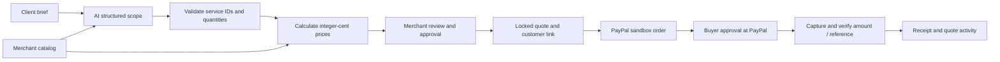

# ScopePay

**From a client brief to a reviewed quote and a PayPal sandbox payment.**

ScopePay is a single-studio quoting workspace built for the PayPal AI Hackathon 2026. An AI assistant maps a client's request to a fixed service catalog and identifies missing scope. The server calculates prices, the merchant reviews and locks the quote, and the client pays through PayPal sandbox. A payment is marked complete only after the server verifies the capture against the approved quote.

## Run locally

Requirements: Node.js **24.13+**, npm, a PayPal **sandbox** application, and access to an Anthropic Messages or OpenAI-compatible Chat Completions endpoint. Node 24.22.1 was used on the remote development host. A GPU is not required by this application.

```sh
npm ci
cp .env.example .env
# Edit .env privately: model configuration and PayPal sandbox credentials.
npm run build
npm start
```

Open **http://127.0.0.1:4181**. Without credentials, you can explore an explicitly labeled example quote, review and approve it, and open the customer view. **The example does not call AI, and payments stay disabled until PayPal is configured. There is no fake payment-success mode.**

For the complete model setup, exact recorded brief, and sandbox buyer walkthrough, see [Judge quickstart](JUDGE_QUICKSTART.md).

For UI development, `npm run dev` serves Vite on http://127.0.0.1:5173 and proxies API calls to the backend. Fonts are bundled locally; the browser makes no model API calls.

## Configure integrations

Set these variables in `.env` or the server environment. Do not commit credentials.

| Variable | Purpose |
|---|---|
| `SCOPEPAY_AI_API` | `anthropic` (default) or `openai` for compatible Chat Completions |
| `SCOPEPAY_AI_KEY` | API key; may be empty for a loopback OpenAI-compatible server |
| `SCOPEPAY_AI_MODEL` | Model name; must support forced tools (Anthropic) or schema-constrained JSON (OpenAI-compatible) |
| `SCOPEPAY_AI_BASE_URL` | Base URL; Anthropic defaults to `https://api.anthropic.com`; required for OpenAI-compatible endpoints |
| `SCOPEPAY_AI_TIMEOUT_MS` | Model request timeout, default 60000; use 180000 for the CPU demo |
| `PAYPAL_CLIENT_ID` | Client ID of your sandbox REST application |
| `PAYPAL_CLIENT_SECRET` | Secret of the same sandbox application |
| `APP_ORIGIN` | Exact browser origin, including port; used for request checks and PayPal returns |
| `ADMIN_PASSWORD` | Workspace password; required with at least 12 characters for a non-loopback deployment |
| `ADMIN_SESSION_SECRET` | Optional persistent random signing secret; otherwise sessions expire on server restart |
| `DATA_PATH` | SQLite path; defaults to `./data/scopepay.sqlite` |
| `HOST`, `PORT` | Defaults to `127.0.0.1`, `4181` |

In Anthropic mode the AI adapter also recognizes `ANTHROPIC_API_KEY`, `ANTHROPIC_AUTH_TOKEN` (Bearer authentication), `ANTHROPIC_BASE_URL`, and `ANTHROPIC_MODEL`. ScopePay-specific variables take precedence. OpenAI-compatible mode uses only the ScopePay configuration and does not inherit Anthropic credentials.

The **Connections** screen reports whether configuration is present, not whether external credentials have been verified. Restart the server after configuration changes. Keep `.env` readable only by its owner, for example `chmod 600 .env`.

### Existing local Qwen model

A local Qwen server can generate quotes without a cloud model key. The remote development setup uses an existing **Qwen3-Coder-30B-A3B-Instruct Q4_K_M** GGUF with llama.cpp, bound to loopback on port 4182. It runs on **CPU** because the shared GPUs are occupied; it is not a GPU performance result. Model weights and llama.cpp are not included in this repository.

To reuse your own existing installation:

```sh
LLAMA_SERVER_BIN=/absolute/path/to/llama-server \
QWEN_GGUF_PATH=/absolute/path/to/Qwen3-Coder-30B-A3B-Instruct-Q4_K_M.gguf \
bash scripts/serve-local-qwen.sh
```

Configure ScopePay in `.env`, then restart it:

```dotenv
SCOPEPAY_AI_API=openai
SCOPEPAY_AI_BASE_URL=http://127.0.0.1:4182/v1
SCOPEPAY_AI_MODEL=qwen3-coder-30b-a3b-instruct
SCOPEPAY_AI_KEY=
SCOPEPAY_AI_TIMEOUT_MS=180000
```

The launcher uses 16 CPU threads, one inference slot, and an 8192-token context. Override `QWEN_THREADS` or `QWEN_PORT` as needed. Existing vLLM servers with schema-constrained Chat Completions can also be configured directly; no new model process is necessary in that case.

### PayPal sandbox setup

1. Sign in to the [PayPal Developer Dashboard](https://developer.paypal.com/dashboard/).
2. Select **Sandbox** and create/select a REST app associated with a sandbox business account.
3. Configure the app's sandbox client ID and secret on the server.
4. Use a **different sandbox personal account** for buyer approval at checkout. In the developer dashboard, open **Testing Tools → Sandbox Accounts**, find the **Personal** account, and open **⋮ → View/Edit Account**. Use its **Email ID** and **Password** on the sandbox checkout page. These are the buyer test credentials, separate from the app's client ID/secret and the developer sign-in.
5. For local testing, browse the app at the exact configured `APP_ORIGIN`. The browser must be able to return to this address after PayPal approval.

The API base is hard-coded to `https://api-m.sandbox.paypal.com`; this prototype has no live-money mode.

## Judge walkthrough

1. Open the workspace. Enter the workspace password if the host uses one.
2. Choose the **Café launch** brief, then **Draft quote with AI**.
3. Inspect the proposed scope. The reference brief should map to a landing page ($600), copywriting ($180), and a social launch pack ($120): **$900 USD**. Model outputs can vary; a merchant reviews every draft.
4. Change a quantity or add a catalog service. The server recomputes the amount. You cannot set an arbitrary price from the browser.
5. Try **Unclear scope** to see questions for unsupported or ambiguous work. Resolve those questions in the merchant note and adjust the scope before approval.
6. Review the checkbox and click **Approve & create payment link**. Approved quotes cannot be edited.
7. Open **Customer view**. Click **Continue with PayPal** and approve using a sandbox buyer account.
8. On return, the server captures the order and checks its ID, quote reference, currency, amount, and capture status. The receipt appears only after verification.
9. Refresh the receipt. The same paid result is returned; the app does not initiate another capture. The merchant can also use **Check payment status** when an order has been captured but the browser did not return successfully.

Do not use a merchant's sandbox business account as the buyer. If a PayPal checkout order has expired, create a new quote; automatic expired-order replacement is not implemented.

## How it works



The model never receives payment credentials, never sets a price, and never calls PayPal. Its output first selects `ready` or `clarification_required`. The JSON schema and Zod validator prohibit service lines in a clarification response and require at least one question. A ready response requires service lines and no open questions. The merchant can add confirmed catalog services and record the resolution before approval. Known service IDs and integer quantities are still validated independently. Merchant review remains necessary: this is not a claim of model-level immunity to prompt injection or hallucination.

The payment path persists its create/capture idempotency keys before the first external call. In-process per-quote locks block concurrent mutation. Capture retries first read the PayPal order and reuse an existing completed result. SQLite stores quotes, payment references, and an activity history. Public quote responses omit the raw client brief, internal events, model usage, and payment-return state.

## Project structure

| Path | Responsibility |
|---|---|
| `src/main.jsx`, `src/styles.css` | Responsive merchant workspace and customer checkout/receipt |
| `server/catalog.mjs` | Sample studio catalog and clearly labeled example data |
| `server/ai.mjs` | Server-side Messages / Chat Completions adapters and output validation |
| `server/domain.mjs` | Price calculation, schemas, receipt verification, public projection |
| `server/paypal.mjs` | Sandbox OAuth, Orders v2 create/read/capture |
| `server/app.mjs` | HTTP routes, approval workflow, authentication, request checks |
| `server/store.mjs` | Persistent SQLite storage |
| `tests/` | Domain, HTTP workflow, and external API adapter tests |
| `submission/` | English project copy, demo script, validation record |

## Validation

```sh
npm test
npm run build
# Both:
npm run check
```

The automated suite uses **test doubles** for model and PayPal responses. It exercises amount tampering, unknown services, approval gates, expiry, mismatched order/state/currency/amount, replay, authentication, and origin checks. These tests are not evidence of a real PayPal sandbox payment. See [the validation record](submission/VALIDATION.md) for actual completed checks and remaining external verification.

Once a real model is configured, `node scripts/evaluate-ai.mjs` runs three small development cases and saves a private report in `data/ai-evaluation.json`. This makes three model calls; it is a smoke check, not an official benchmark or evidence of real-world accuracy.

## Deployment and scope

Run **one Node process** with persistent storage. Public hosting requires HTTPS, a strong `ADMIN_PASSWORD`, and the exact `APP_ORIGIN`. Keep the workspace password out of the public repository; give judges separate access instructions. No public deployment is required if judges can run the repository.

This is a sandbox hackathon prototype for one merchant, not a production billing service. It does not implement multi-tenant authorization, tax calculation, refunds, dispute handling, recurring billing, background webhook processing, or automated order renewal. The activity list is an application history, not a tamper-proof audit system. Model inference quality and real user impact have not been measured. Service packages and prices are illustrative and editable in `server/catalog.mjs`; approved quotes retain their stored amounts.

## References and credits

- [PayPal hackathon requirements](https://paypalaihackathon.devpost.com/)
- [PayPal Orders v2](https://developer.paypal.com/api/orders/v2)
- [PayPal OAuth](https://developer.paypal.com/api/rest/authentication/)
- [PayPal Orders integration migration details](https://developer.paypal.com/api/rest/integration/orders-api/v1-v2-migration)
- [Anthropic TypeScript API reference](https://github.com/anthropics/anthropic-sdk-typescript)
- [llama.cpp server](https://github.com/ggml-org/llama.cpp/tree/master/tools/server)
- [Qwen3-Coder-30B-A3B-Instruct](https://huggingface.co/Qwen/Qwen3-Coder-30B-A3B-Instruct)
- [Node.js SQLite](https://nodejs.org/api/sqlite.html)

React, Vite, Zod, and Lucide supply the app framework, build tooling, validation, and icons. Manrope and DM Sans are bundled through Fontsource under their respective open font licenses. ScopePay source is available under the [MIT License](LICENSE). PayPal is referenced as the payment integration; ScopePay is an independent hackathon project.
